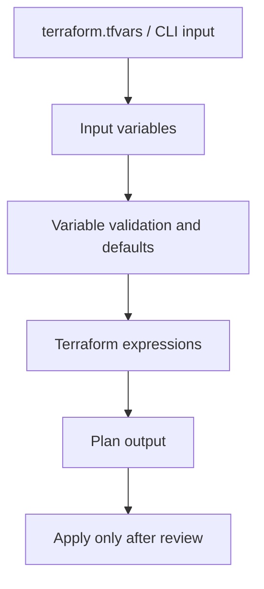

# Terraform variables practice — Architecture & Interview Guide

This is a legacy Terraform learning workspace. The diagram is a conceptual teaching flow, not evidence of provisioned Azure resources.

## Architecture diagram

## Interview questions

1. 1. What is the difference between input and output variables in Terraform?
2. 2. How do type constraints improve module safety?
3. 3. When should a variable have a default value?
4. 4. How do tfvars files differ from environment variables?
5. 5. What is sensitive = true and what does it not protect?
6. 6. How would you validate a CIDR input?
7. 7. What is the difference between count and for_each?
8. 8. How do you avoid committing secrets in tfvars?
9. 9. What happens when a required variable is not supplied?
10. 10. How would you refactor this exercise into a reusable module?

## Interview preparation note
Be ready to explain the design decision, security boundary, failure mode, operational signal and validation evidence for each answer. Clearly separate implemented code, CI-validated configuration, cloud-deployed resources and future roadmap items.
