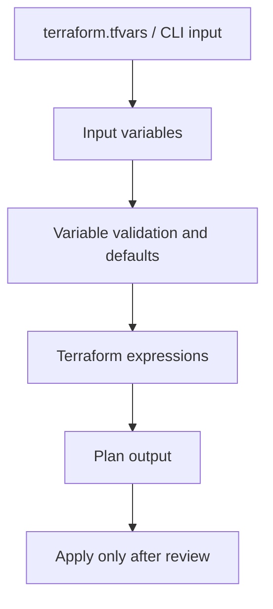

# Terraform variables practice — Architecture & Interview Guide

This is a legacy Terraform learning workspace. The diagram is a conceptual teaching flow, not evidence of provisioned Azure resources.

## Architecture diagram

## Interview questions

1. 1. What is the difference between input and output variables in Terraform?
2. 2. How do type constraints improve module safety?
3. 3. When should a variable have a default value?
4. 4. How do tfvars files differ from environment variables?
5. 5. What is sensitive = true and what does it not protect?
6. 6. How would you validate a CIDR input?
7. 7. What is the difference between count and for_each?
8. 8. How do you avoid committing secrets in tfvars?
9. 9. What happens when a required variable is not supplied?
10. 10. How would you refactor this exercise into a reusable module?

## Interview preparation note
Be ready to explain the design decision, security boundary, failure mode, operational signal and validation evidence for each answer. Clearly separate implemented code, CI-validated configuration, cloud-deployed resources and future roadmap items.

## Interview questions — suggested answers

### 1. Answer

Input variables let callers configure a module; outputs expose selected results to callers. Variables are inputs, outputs are the module's public contract.

### 2. Answer

Type constraints catch invalid structures early. Prefer string, number, bool, list, map and object types over unconstrained any when the expected shape is known.

### 3. Answer

Use defaults for safe, non-sensitive values that are genuinely optional. Keep environment-specific and security-sensitive choices explicit.

### 4. Answer

A tfvars file supplies values to declared variables; environment variables using TF_VAR_ can supply the same inputs. Neither should contain committed secrets.

### 5. Answer

sensitive=true redacts values in normal CLI output, but does not encrypt values in state or prevent every possible disclosure. Protect state and secret sources separately.

### 6. Answer

Use a string type plus validation with can(cidrhost(var.cidr, 0)) or an equivalent CIDR check, and add constraints for allowed ranges.

### 7. Answer

count addresses instances by numeric index; for_each addresses them by stable keys. for_each is usually safer when instances have distinct identities.

### 8. Answer

Commit a .tfvars.example with placeholders, ignore real tfvars, use a secret manager or environment injection, and scan commits for secrets.

### 9. Answer

Terraform prompts interactively or errors in non-interactive automation if a required input has no value. CI should provide explicit inputs.

### 10. Answer

Move repeated resources into a child module, define typed inputs and outputs, pin provider versions, add examples, and validate with fmt/init/validate and tests.